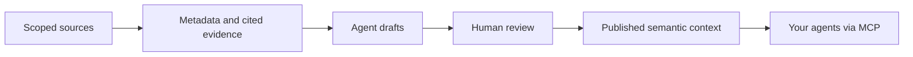

<p align="center">
  
</p>

# Knowledge Layer

**Give your agents context they can trace.**

An open source, self-hosted semantic layer for AI agents. Connect scoped data and
document sources, build a shared knowledge graph, and publish reviewed definitions,
relationships and metrics through Model Context Protocol (MCP).

[](https://github.com/Quiet-Victory-Labs/knowledge-layer/actions/workflows/verify.yaml)
[](LICENSE)

[Project website](https://quiet-victory-labs.github.io/knowledge-layer/) ·
[Get started](docs/getting-started.md) · [Documentation](docs/README.md) ·
[Ask a question](https://github.com/Quiet-Victory-Labs/knowledge-layer/discussions) ·
[Contribute](CONTRIBUTING.md)

Knowledge Layer is a **public source alpha**. Evaluate it with synthetic or
appropriately scoped sources; check the [capability matrix](docs/capability-support-matrix.md)
for connector support and qualification limits.

## Why use Knowledge Layer?

A table name does not tell an agent what a customer means by “active.” Two columns
with the same label may use different units. A document can describe a metric
without showing which source version supports it.

Knowledge Layer makes those questions explicit. Agents draft meaning from cited
source evidence. People review the definitions and relationships, then publish
current context for reuse. Conflicting, stale and unresolved claims stay visible.

| What you need | What the layer provides |
| --- | --- |
| Shared business definitions | A scoped glossary and ontology with evidence, review state and source versions. |
| Relationships you can inspect | A collective knowledge graph with source neighborhoods, provenance and reviewed term bindings. |
| Consistent analytical context | Typed grain, join and metric proposals with exact evidence bindings and human review. |
| Context your agents can reuse | Bounded MCP and HTTP handoffs, published retrieval and graph exports. |

## From source evidence to reusable context



1. **Connect** the sources and scopes you want to evaluate.
2. **Draft** definitions, relationships and supported metric contracts with your agent.
3. **Review** the exact claims and their evidence; leave uncertain meaning unresolved.
4. **Publish** current reviewed context for authorized agents to consume.

The layer supplies context and query guidance. Source queries and analytical result
verification use separately authorized source tools. Review records an accountable
decision; it does not certify business truth.

## Start with the bundled examples

You need Docker Engine with Compose and Python 3.11 or newer on Linux or macOS.
The installer builds from this checkout; the default profile needs no model account
or cloud service.

```sh
git clone https://github.com/Quiet-Victory-Labs/knowledge-layer.git
cd knowledge-layer
./knowledge-layer init --examples
./knowledge-layer start
```

Open [http://127.0.0.1:4173/](http://127.0.0.1:4173/), use the private bootstrap
token from the file shown by the launcher, and create your owner account. Setup
can connect the bundled synthetic sources. Follow the
[first-context walkthrough](docs/getting-started.md) to draft, review and publish.

Configure your existing agent client for a project:

```sh
./knowledge-layer agent --client codex --project /absolute/path/to/project
# Also supports --client claude and --client cursor.
```

Load the credential reference printed by Setup, confirm the client's server trust
prompt, then ask it to call `get_build_handoff` and identify its visible sources.
Configuration helpers do not prove a live client connection. Agents draft; the
owner reviews and publishes.

Stop the local installation with `./knowledge-layer stop`. See
[self-hosting](docs/self-host.md) for source folders, remote connectors, credentials,
backup and recovery.

## Open semantics, inspectable evidence

- **Resource Description Framework (RDF)** exports represent source-backed graph records.
- **Simple Knowledge Organization System (SKOS)** represents concepts and definitions.
- **PROV Ontology (PROV-O)** records source and snapshot provenance.
- Optional **Shapes Constraint Language (SHACL)** validation checks saved graph structure.

Explore the [collective graph](docs/collective-knowledge-graph.md),
[semantic contracts](docs/semantic-contract-agent-loop.md) and
[offline RDF validation](docs/rdf-validation.md). Graph structure, current evidence
and human approval remain distinct checks.

## Connectors and catalog context

Start with mounted structured files and documents. Other paths include database
and lakehouse metadata, scoped external adapters, and selected catalog export
translations. Availability and qualification vary by connector and deployment.

[Supported paths and limits](docs/capability-support-matrix.md) ·
[Catalog integrations](docs/catalog-integrations.md) ·
[External adapter contract](docs/external-connector-protocol.md)

Knowledge Layer does not write connected enterprise sources. Local profiling can
read rows, document evidence retains cited passages, and optional semantic sampling
can retain bounded values. Choose source credentials, retention and agent egress
policy deliberately. Registry grants do not mirror native row, field or document
permissions. See [trust boundaries](docs/architecture.md) and
[source access](docs/source-access.md).

## Try the Python SDK

The disposable synthetic example discovers a source, reviews a specific grain
assertion, publishes it, and verifies SDK MCP retrieval of that same source.
It runs no model and queries no customer system.

```sh
uv sync --frozen --all-extras
uv run --no-sync python examples/01_quickstart_sdk.py
uv run --no-sync python examples/02_catalog_federation.py
```

Native Python development requires Python 3.14. Install from this checkout;
PyPI publication is not configured. The catalog example translates scoped
synthetic exports without persisting records; incomplete pagination is refused.

## Help shape the project

- [Ask a usage question or share feedback](https://github.com/Quiet-Victory-Labs/knowledge-layer/discussions).
- [Report a reproducible bug](https://github.com/Quiet-Victory-Labs/knowledge-layer/issues/new?template=bug_report.yml).
- [Propose a feature](https://github.com/Quiet-Victory-Labs/knowledge-layer/issues/new?template=feature_request.yml)
  or [request a connector](https://github.com/Quiet-Victory-Labs/knowledge-layer/issues/new?template=connector_request.yml).
- [Contribute](CONTRIBUTING.md) documentation, synthetic examples or focused fixes.
- Report vulnerabilities through the private route in [SECURITY.md](SECURITY.md).

For maintainers: [verification and development](CONTRIBUTING.md),
[release requirements](RELEASING.md), [governance](GOVERNANCE.md) and
[release readiness](docs/release-readiness.md). Tests and synthetic drills establish
declared behaviors, rather than general production-scale performance or model uplift.

Released under [Apache 2.0](LICENSE). Third-party notices are in [NOTICE](NOTICE).
Public development starts from a sanitized source snapshot; original private pilot
and development history remain separate.
