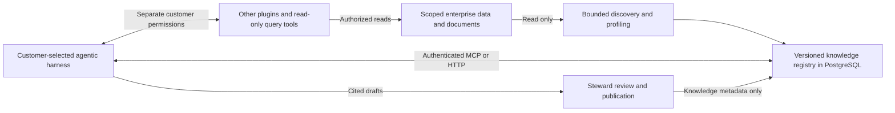

# Product architecture and trust model

## Intended product

Knowledge Layer provides a shared company understanding capability: source metadata, glossary, ontology, semantic contracts, metric definitions, and the evidence supporting them. Customers connect permission-scoped structured and unstructured sources, curate that context, and reuse it across departments and analytical tasks. Covering the whole company is a curation objective; connected inventory or model-generated descriptions do not automatically certify complete company knowledge.

That estate can already contain catalogs, glossaries, ontologies, metric stores, semantic layers and data products maintained by different business units. The intended federation reads and preserves those existing definitions, then helps the customer reconcile their scopes and relationships; it does not require replacing the systems that own them. Dataplex, Databricks, Collibra, Alation and DataHub are examples of upstream systems in this product goal, not currently qualified vendor connectors.

Customers choose the external agentic harness that both curates and later consumes the context: for example Codex, Claude Code, Cowork, Gemini, a cloud or self-hosted harness, a custom runner, or a Jev-based integration. Authenticated MCP and HTTP are the integration boundary. The product does not require a particular model, in-app chat, or agent scheduler. The optional [reference curation runner and decision adapter](model-neutral-curation.md) are integrations with that boundary; they do not make Knowledge Layer an agent orchestration runtime.

[Company guidance](company-guidance.md) stores portable procedures and normative rules separately from observed business facts. Immutable drafts require steward publication before consumer resolution. Audience grants and explicit task, business-unit and source scopes select applicable context; pinned published-source dependencies are revalidated. Declared key/value conflicts block use and export. An agent can propose guidance, but source text has no instruction authority merely because it was imported. The resolver describes current authorized context, not complete enterprise policy coverage. Prose guides the customer harness; the service and source permissions enforce their own access boundaries.

The product goal is end-to-end agent curation across the customer's connected estate, including unattended operation when the customer authorizes it under their governance policy. Automation must preserve evidence, source permissions, revision checks and accountable decisions. The current alpha separates agent proposals from steward approval and publication; fully automated estate-wide curation and publication are not yet qualified.

The intended metric store holds governed business definitions, units, formulas, dimensions, cohort and time-grain rules, and source lineage so customer tools can compute consistent results. The current alpha supports reviewed single-measure aggregation definitions, query guidance and unexecuted SQL examples; a complete portable composite-metric compiler and calculated metric service are not implemented.

The same harness can use its other customer-authorized tools alongside Knowledge Layer. Slack, Google Workspace, Figma, Alation, BigQuery, Snowflake, Affogata, and similar systems illustrate that wider tool environment. These names are not a claim that Knowledge Layer ships or has qualified a native connector for each system. A harness may retrieve company definitions here, inspect supporting context with another plugin, and execute read-only SQL through a separately authorized source tool. Source, query, and result verification remain part of that analytical work.

The project is Apache-2.0 licensed and designed for inexpensive self-hosting. Its repository remains private during alpha qualification; the license and architecture do not by themselves establish a public release or production readiness.

## Components and responsibilities

Connectors read bounded source metadata and optional document excerpts or semantic samples. Source rows remain in the source unless a deployment explicitly opts into bounded retention. PostgreSQL stores connection definitions, snapshot versions, evidence, typed concepts and relationships, proposals, and decisions. The service projects a navigable graph from those records; a separate graph database is not required.

| Responsibility | Knowledge Layer | Customer environment |
| --- | --- | --- |
| Source connection | Operator-enabled connectors, scoped discovery, bounded evidence | Source credentials, read-only accounts, network access and source policy |
| Curation | Work packets, typed proposals, citations, review, drift and versioned publication | Chosen harness, interpretation, accountable steward decisions |
| Consumption | Scoped glossary, ontology, table/field/grain/join contracts and approved metric definitions over MCP/API | Task reasoning, other tools, source queries and independently verified results |
| Metric use | Definitions and query guidance, with trust and execution state | Actual provider-specific SQL, aggregation/type checks, performance checks and result computation |

The platform never writes connected enterprise sources. Its own PostgreSQL registry is writable because connections, evidence, proposals, decisions and audit history are product metadata. Connecting or refreshing a source changes that registry; it does not grant an agent permission to mutate the source.

## Source boundary

Connectors use operator-provisioned secret references and a configured scope. Local files stay inside a mounted root. Native database discovery reads schema/catalog metadata, not customer application rows. SQL discovery verifies read-only and timeout effects for qualified PostgreSQL, ClickHouse and SQLite dialects; unsupported dialects refuse with an adapter path. Iceberg reads catalog metadata without scanning data files. Object storage, Iceberg SDKs and external adapters are optional integrations. The [adapter contract](external-connector-protocol.md) lets a separately deployed connector normalize SaaS metadata without adding its SDK to the core image. A connector appearing in the menu is not proof that a specific vendor account, auth mode, or permission model has been qualified. See [native qualification](native-connector-qualification.md) for exact policies.

Read-only access must also be enforced at the source: provision restricted database roles, object/catalog credentials and external adapters that cannot mutate enterprise data. A client's SQL settings are one layer, not a substitute for the account's source permissions. Agents receive operator-enabled tools and source scopes, not arbitrary source URLs or credentials. In the OIDC pilot, source creation and refresh additionally require operator policy approval and appropriate metadata grants. Knowledge Layer's grants cover the stored connection context; they do not mirror a warehouse's row policies or a document system's ACLs. Split connections along audience boundaries and choose retention/egress policy before collecting excerpts or samples.

Local files can provide bounded structured profiles and text evidence from Markdown, text, HTML, DOCX and text-bearing PDF. Text extraction, retention and candidate coverage have explicit completeness states; OCR and exhaustive document understanding are not implied. Source text is evidence to inspect, not instructions for the harness to obey.

## Federation and reconciliation

The [collective workspace graph](collective-knowledge-graph.md) is the default map and is also available over HTTP/MCP and RDF. It projects authorized current semantic snapshots together, including all observed fields, pending definition text, source provenance and explicit cross-source citations. Shared-label clusters support reconciliation while retaining original definitions. Evidence-backed `term_binding` assertions can relate source assets/fields to exact document or imported concepts through the existing review ledger. Their continued effectiveness requires current target meaning review and source evidence; they do not create table joins or automatic equivalence. Bounded pages and neighborhoods expose coverage explicitly.

The current registry separates connections and versions, and external adapter pointers are namespaced by provider and scope. Its bounded federated graph links source assertions to explicit document or imported semantic citations from other authorized connections. Reviewed document definitions appear as a cited glossary; reviewed imports appear separately as cited upstream definitions. Imported citations require both current local meaning review and an effective source assertion bound to that exact current evidence. Errors, revision changes, archived reviews or denied grants suppress them. Protocol 1.2 also imports bounded, namespaced upstream definitions as observed source evidence. RDF and Apache Ossie projections export local knowledge; imported ontology terms do not create an upstream relationship graph.

| Capability | Current alpha | Target product contract |
| --- | --- | --- |
| Upstream imports | Adapter 1.2 accepts six typed upstream definition kinds; protocol 1.3 separately stages full native asset, semantic-definition, document and relationship observations, including portable customer catalog exports | Qualified vendor accounts, richer reviewed semantic bindings and imported relationship graphs, with upstream identity and revision preserved |
| Names and authority | Connection/provider/scope and upstream namespace/native ID; declared owner, authority and review provenance remain source assertions; local cited review is separate | Business-unit authority policy and accountable cross-catalog mappings; imported approval is provenance, not automatic local approval |
| Conflicting definitions | Explicit source definitions and optional native `unit`/`formula` are retained; some document conflicts and duplicates are detected; matching labels remain suggestions | Compare scoped definitions, units, formulas, cohorts and time rules; preserve disagreement and provenance until an accountable mapping or reconciliation decision exists |
| Permissions | Operator-approved source access and grants for whole stored connections | Preserve the upstream permission boundary in import and retrieval; source-native ACL/field policy propagation needs separate implementation and qualification |
| Changes and deletions | Bounded snapshot comparison detects added, removed and revised assets; changed imported content or provenance invalidates bound local reviews; complete-scope removal omits the asset from current context and retains prior versions | General semantic dependency reconciliation, explicit upstream deletion/withdrawal records, replayable reconciliation and permission-revocation handling |

Adapter 1.2 is an operator-profile opt-in; 1.0 and 1.1 remain supported. These legacy versions require complete bounded responses and reject continuation cursors. Protocol 1.3 is a distinct inventory-only path: the existing worker stages complete pages, validates a scoped manifest and atomically switches its current discovery head. It does not publish a semantic snapshot. A list page is not proof of the full estate. There is no automatic business-unit authority resolution or general cross-catalog equivalence service. A catalog's technical foreign key or lineage pointer does not establish business equivalence.

The [catalog-agnostic import](catalog-agnostic-import.md) accepts strict `knowledge-catalog-export-v1` packages captured by customer-authorized tools or thin exporters. Optional data-only JSON Pointer mappings preserve selected native records without running queries, expressions or vendor SDKs. Operator profile bindings pin provider/account identity, namespace, coverage selectors and mapping; the protected sample checks the matching public platform profile digest. The same protocol 1.3 pager/worker and PostgreSQL inventory store enforce finite budgets. Complete returned payloads retain unknown field coverage and native clocks, source policies, conflicts and unresolved relationship references as evidence. This supports generic ingestion, not native permission propagation, current-source freshness, approved joins or automatic company understanding. Offline tests and synthetic managed-worker proof remain separate from live vendor qualification.

A protocol 1.2 definition retains its native ID, kind, namespace, exact definition and declared version, with optional observation clock, owner, authority, reference, review status, unit and formula. A native version may be null when the source supplies none; the service still binds evidence to its content revision. Native units and formulas are declarations to inspect, not compiled metric semantics. Upstream approval does not become Knowledge Layer approval, and identical names do not create equivalence. Imported concepts start as candidates with observed upstream trust; a steward can review cited local interpretations through the existing proposal workflow. Definition, native version, authority, unit, formula and pointer changes invalidate existing reviews bound to the changed evidence. An observation-clock-only change does not certify a new meaning.

External adapters can carry scoped glossary and metric definitions with native namespaces, units and provenance. Absent native version, formula, owner, review status and observation clocks remain unknown; imported declarations do not become computed metrics or locally approved meaning. Native vendor authentication, ACLs and deployment require separate qualification. See the [adapter contract](external-connector-protocol.md).

Legacy import identity distinguishes the connection, upstream namespace, native object ID and definition kind; revisions bind its content and provenance. Portable catalog inventory additionally pins provider, native source identity, namespace, selector coverage and native type/ID, while retaining declared permissions separately from local authorization. Accountable authority mappings and richer reviewed semantic bindings remain targets. Original definitions and ownership stay separate from local interpretations. Reconciliation should write only Knowledge Layer metadata. A missing object after a failed, partial or newly denied read cannot be treated as an upstream deletion. Complete-scope removal changes current inventory while retaining history; it does not emit an explicit upstream tombstone or withdrawal record.

Customers should control refresh cadence and reconciliation policy. The [refresh queue](refresh-jobs.md) stores hourly, daily, weekly and monthly schedules with explicit timezone, owner, pause/resume and freshness age. The existing worker coalesces missed occurrences, rechecks source approval and direct owner grants, and separates source attempts from completed inventory clocks. The target is customer-scheduled discovery followed by drift assessment, dependency revalidation and evidence-bound curation under customer policy. Self-healing means bounded retries and repair of local knowledge bindings where evidence permits; it must not invent a missing definition, silently approve a conflict or write repairs to an enterprise source. Automatic semantic repair and guaranteed freshness remain unimplemented assurances; scheduled source discovery does not automatically launch or approve a harness's curation work.

## Meaning and evidence

The product journey is deploy → connect agents → connect sources → agent-built drafts → human acceptance → agent consumption. Agents receive a bounded build handoff with current source pins and both meaning and contract work. The UI can preview an exact selection of drafts with their supporting evidence, then accept them together. Acceptance records all selected decisions and one review snapshot in a single registry transaction. Optional steward publication follows through the existing publication gate; a blocked publication returns an explicit completed-review result. Unselected drafts remain pending. See the [build flow](agent-build-flow.md).

Discovery produces candidate assets, fields, business concepts, metrics, grains, joins, and document terms. Assertions retain source identity, snapshot version, evidence IDs, and trust state. A changed source creates a new snapshot; affected context can become stale. Agents may search evidence and submit version-checked proposals through the [MCP workflow](agent-skill-install.md). A steward can approve or reject individual proposals. Optional [decision triage](model-neutral-curation.md#optional-decision-triage) routes bounded work before a generative model call; its score never counts as evidence or approval. The service does not infer approval from an agent's confidence or prompt.

The [optional offline RDF validator](rdf-validation.md) checks saved Turtle exports against [packaged SHACL Core shapes](../src/knowledge_layer/schemas/knowledge_shapes.ttl), with bounded input and graph size, no inference, custom shapes, JavaScript, advanced rules or IRI fetching. It verifies projection structure, including provenance and separate draft/review states; it does not establish source truth, permissions, freshness or query execution. The base service still validates contracts in Python. SHACL validation is not a per-request export check or a publication gate.

The same harness can first call compact `get_workspace`, `next_work`, `search_evidence`, `propose_meaning` and `propose_contract`, then return as a consumer using `resolve_context`, `get_contract` and ontology exports. Source management tools are exposed only when the operator enables them. Pending drafts and retrieval suggestions stay distinct from approved meanings; an approved metric definition is not a computed metric result. [Semantic contracts](semantic-contract-agent-loop.md) include provider-specific query guidance and unexecuted SQL examples. The harness must verify the latest source schema, types, scope, grain, identity, cardinality and query results through its authorized source tools. Agents cannot publish their own claims through the agent API or MCP.

## Deployment footprint

The base image combines the API and built web UI. The [local Compose profile](../compose.yaml) runs that image plus PostgreSQL, binds host ports to loopback and mounts the example source root read-only. It does not require a model server, vector database, separate graph service or connector SDK extras. Optional local semantic reranking and connector drivers can be added for the customer's selected capabilities.

The [OIDC pilot](oidc-pilot.md) adds a separate bounded refresh worker and uses customer-managed PostgreSQL, an IdP and an HTTPS proxy. A [Helm chart](../charts/knowledge-layer/) is available for pilot evaluation. Standard containers and PostgreSQL are the intended portable deployment basis for local hosts or customer infrastructure on GCP, AWS or Azure; this repository does not qualify every cloud, managed service, private network or authentication combination. Operators still provide secrets, backups, retention, source permissions and deployment monitoring.

Keeping models and analytical data execution outside the base service limits its mandatory footprint. Infrastructure cost, memory/latency under a company's corpus, and external harness/model costs still need measurement; there is no guaranteed low-cost or production-scale SLO.

## Identity and operation

The local profile has a loopback-only UI and a demo bearer token for agent endpoints. The OIDC pilot adds browser login, agent JWT validation, group-based steward review, CSRF protection, and connector allowlists for one organization. Read [deployment details](oidc-pilot.md) before exposing it remotely.

## Current limits

- OIDC source-level metadata grants are enforced for browser, HTTP agent, search, snapshots, graph, and MCP reads. Source-native row/document ACL mirroring, field-level filtering, and multi-organization isolation remain unimplemented.
- A [steward publication gate](source-publication.md) can mark the current reviewed source snapshot ready for agent use. Owner decisions are bound to the proposal and cited evidence; changed claims or evidence require re-review. The gate never turns candidate claims into certified facts. Refresh, source errors, and stale approved evidence suspend readiness. Governance mutations have an [operator exportable event ledger](audit-events.md). OIDC requests emit bounded access and per-source registry-read events. Source-native read attribution, retention, external archive, monitored delivery, and field-level policy remain deployment gates.
- OIDC discovery uses a PostgreSQL job ledger, one active job per source, bounded queue capacity, a separate worker process, expiring leases, retries, cancellation, and a child-process timeout. The local demo remains synchronous. Jobs are at least once: a worker crash after saving a snapshot but before recording success may reprofile and create another version. Per-source credential isolation, representative load tests, monitoring, and customer recovery objectives remain deployment gates. OIDC installs use [versioned PostgreSQL migrations](schema-migrations.md) and fail startup on schema drift.
- External Snowflake, BigQuery, Redshift, SaaS, and customer IdP integrations have not been qualified with real credentials and denied-grant tests. A disposable local Keycloak/PostgreSQL identity drill covers the protocol path but not a customer's provider or HTTPS deployment.
- Protocol 1.2 provides observed imports for six upstream definition kinds; the federated graph carries document and reviewed imported semantic citations. Protocol 1.3 adds bounded full-native inventory and catalog-agnostic exports through the existing worker and schedules. Qualified vendor accounts, imported relationship graphs, business-unit authority reconciliation, arbitrary portable metric compilation, alert delivery, representative multi-worker load and automatic semantic repair remain product and qualification gaps.
- No production-scale latency, load, or agent token-cost benchmark. Local MCP schema bytes are only a transport measurement.
- Browser and agent source lists use bounded, authorized cursor pages, a PostgreSQL tenant/time/ID seek index, and batched current-state projection in groups of 20. Internal cross-source work traversals stream those authorized pages. Document evidence search reads the current snapshot's evidence projection directly under the same grants and retains only the requested top matches. It searches all current snapshots instead of silently stopping after 30 connections. Concept search uses a grant-filtered PostgreSQL GIN index over current concepts and sends at most 256 lexical candidates to the optional local embedding model. It reports when semantic reranking was limited to that candidate set. A dense local 20,000-source PostgreSQL drill passed, but semantic-only recall outside the lexical candidate set, full API concurrency, source-read log volume, and curation memory use still need representative qualification. Page cursors are navigation hints, not a snapshot of changing grants.
- Decision-model quality has not been measured on a steward-labeled enterprise corpus. A gate remains an operator-controlled pilot setting, not an automatic publication policy.

These are release gates, not hidden automatic behavior. The public alpha includes explicitly synthetic examples and bounded local qualification records. Private source-specific pilot narratives are excluded from the public tree. Review the [public fixture provenance](public-fixture-provenance.md); synthetic results cannot establish customer permissions, whole-company certification or qualification of every harness and cloud.

Durable external-agent builds use `knowledge_builds` and `knowledge_build_tasks` (migration `0016_builds`). Runs retain bounded source scope and budgets; tasks retain exact evidence, source snapshot/version, leased agent subject and atomic proposal/outcome receipts. Both MCP surfaces and agent HTTP share the same registry; browser routes expose progress and cancellation. The optional customer-owned `knowledge_layer.build_worker` uses native CLIs or a compatible endpoint without adding a model to the service. Human review uses the independent source manager/steward gate.
