# Catalog-agnostic import

Knowledge Layer accepts a portable catalog export captured by the customer's
authorized read-only tools, harness or integration. A thin exporter can adapt a
vendor API or existing metadata export without adding that vendor's SDK, model
or runtime to the core service. The current path preserves returned native
records as untrusted discovery evidence; vendor accounts, native permissions and
business meaning still require separate qualification.

The harness can [cite exact inventory observations](inventory-semantic-citations.md)
when proposing locally reviewed meaning for an existing dataset or metric. The
raw catalog record retains its separate authority and permission boundaries.

```mermaid
flowchart LR
  N[Native catalog or semantic system] -->|Authorized metadata reads| H[Customer tool or thin exporter]
  H --> E[Private portable export or captured JSON]
  E -->|Optional data-only mapping| A[Scoped sample adapter]
  A -->|Protocol 1.3 pages| W[Existing refresh worker]
  W --> I[Scoped inventory in PostgreSQL]
  I -->|MCP or HTTP evidence| C[Customer harness]
  C --> R[Separate interpretation and review]
```



## Portable package

`knowledge-catalog-export-v1` requires exactly `schema_version`, `scope`,
`observation`, `listing_complete`, `next_cursor`, `record_count` and `records`.
JSON must be unique-key, finite UTF-8, including nested keys and strings.
The following is synthetic and demonstrates the shape, not a vendor schema:

```json
{
  "schema_version": "knowledge-catalog-export-v1",
  "scope": {
    "provider": "customer_catalog",
    "source_identity": "catalog-account-a",
    "namespace": "finance",
    "scope_id": "finance",
    "selectors": ["domain:finance"]
  },
  "observation": {
    "exported_at": "2026-10-03T00:00:00Z",
    "source_observed_at": null,
    "native_revision": 0,
    "field_coverage": {"definitions": "complete", "policies": "unknown"},
    "redaction": "unknown"
  },
  "listing_complete": true,
  "next_cursor": null,
  "record_count": 1,
  "records": [{
    "native_id": "term:revenue",
    "native_type": "GlossaryTerm",
    "kind": "semantic_definition",
    "name": "Revenue",
    "native_record": {
      "definition": "Revenue excludes refunds.",
      "unit": "USD",
      "owners": ["Finance"],
      "native_approval": "approved",
      "relationships": [{"target_id": "dataset:orders"}],
      "unknown": null,
      "zero": 0,
      "empty": "",
      "disabled": false
    }
  }]
}
```

| Part | Contract |
| --- | --- |
| Scope | Exactly `provider`, `source_identity`, `namespace`, `scope_id`, `selectors`. Provider/scope IDs use the existing safe selector syntax. Identity/namespace are bounded nonblank strings; selectors contain 1–200 distinct strings. The whole scope must match the operator's expected scope; selector order alone is ignored. |
| Observation | Exactly the five fields shown. Both clocks are aware ISO strings or null; no refresh time replaces an unknown source clock. Native revision is null, a string of at most 512 characters, or a signed 64-bit integer; booleans refuse. |
| Coverage/redaction | `field_coverage` has 1–32 named entries with `complete`, `partial`, `unknown` or `unavailable`; `redaction` is `none`, `partial` or `unknown`. These are producer declarations, preserved unchanged. |
| Listing | `listing_complete` must be true, `next_cursor` null, and integer `record_count` exactly the array length. Zero declares a completed empty scope. A partial, failed or denied scan must not be packaged as that empty result. |
| Record | Exactly `native_id`, `native_type`, `kind`, `name`, `native_record`. IDs/types are bounded nonblank strings; name may be null or an empty string. Kinds are `asset`, `semantic_definition`, `document`, `relationship`; native payload is a complete returned JSON object. |

IDs bind provider, source identity, namespace, native type and native ID, not a
display name. Full native payload and declared scope/observation remain in
evidence. Unknown fields, formulas, owners, approvals, policy references,
relationships and tombstones stay opaque. Missing, null, zero, empty and false
retain distinct states. Same-named conflicting definitions remain distinct.
Relationships are declared references, not proven graph edges, joins or identity
equivalence. Import does not compile a metric or transfer native approval.

Complete listing is separate from complete field coverage. A package may list
every selected object while declaring partial ownership or unknown policies.
“Full returned native record” describes the captured object; it does not certify
all fields or relationships available at the source. Global environment variables,
tokens and arbitrary export metadata are not part of this envelope. The exporter
must deliberately remove sensitive material from selected native objects and
declare redaction; the importer is not a general secret detector.

## Check, map and compute pins

Create a private operator contract containing exactly `scope`, `observation`,
`listing_complete`, `next_cursor`, `record_count` from the package above. Keep
artifacts and configuration in a customer-owned directory with mode 0700 and
files with mode 0600. These commands read explicit regular local files, make no
network calls and do not write registry or source data:

```sh
python -m knowledge_layer.adapters.catalog_cli check \
  --input /absolute/private/export.json --contract /absolute/private/contract.json
```

For a captured native JSON export, an optional mapping chooses exact fields with
JSON Pointers. For example, a synthetic `/entities` array with GUIDs and type
names can use:

```json
{
  "records_pointer": "/entities",
  "id_pointer": "/guid",
  "id_encoding": "string",
  "type_pointer": "/typeName",
  "native_type": null,
  "name_pointer": "/attributes/name",
  "kind_by_type": {"AtlasGlossaryTerm": "semantic_definition", "Table": "asset"}
}
```

Mappings are data-only: no JSONPath, scripts, expressions, URLs or credential
discovery. Missing configured fields and unmapped native types refuse. An
explicit `integer_decimal` ID encoding preserves the original integer in
evidence while using its decimal identity string. A null `type_pointer` requires
an explicit `native_type`; a null `name_pointer` deliberately leaves the display
name unknown. The selected native object is preserved unchanged, without
fetching dependencies or inferring its permissions.

```sh
python -m knowledge_layer.adapters.catalog_cli check \
  --input /absolute/private/native.json --contract /absolute/private/contract.json \
  --mapping /absolute/private/mapping.json
python -m knowledge_layer.adapters.catalog_cli map \
  --input /absolute/private/native.json --contract /absolute/private/contract.json \
  --mapping /absolute/private/mapping.json
python -m knowledge_layer.adapters.catalog_cli pins \
  --contract /absolute/private/contract.json --profile /absolute/private/platform-profile.json \
  --mapping /absolute/private/mapping.json
```

`check` returns content-free hashes/counts, with input and generated export hashes
separate. `map` prints the complete portable package: its output contains company
metadata and needs the same private storage policy. `pins` prints public digests
only. Omit `--mapping` for an already portable package.

With a mapping, the operator contract supplies the generated package's
observation, count and completion declarations. With an already portable input,
`check` validates the operator contract, compares the exact expected scope
(ignoring selector order), and requires the package's observation, count and
completion declarations to match. A producer timestamp is labeled `declared`,
not verified; check receipts explicitly report `clock_live_validated: false`.

`pins` computes a **hypothetical completed profile**: the supplied platform
profile plus the returned binding for this scope. Its `digest_basis` is
`supplied_profile_with_returned_scope_binding`; no profile file is written.
The operator must write the returned `scope_binding_digest` into the actual
profile's `inventory_scope_bindings[scope_id]`. The optional binding pins native
account identity, namespace, selector coverage and mapping. It is included in the
platform profile digest, so changing any of those cannot silently reuse the old
scope's comparable inventory. Digests grant no access and attest no vendor truth.

## Serve the protected sample

The [native sample](../examples/native_semantic_adapter.py) accepts an
operator-owned named scope with `format: catalog_export`, `provider`, `artifact`,
`expected_scope` and `platform_profile`. `expected_scope` is the exact scope
object above. `platform_profile` is the matching public template of the actual
protocol 1.3 profile: endpoint, provider, revision, source identity, allowed scopes
and actual `inventory_scope_bindings`, without its bearer token. The sample
checks the request's profile digest and binding before reading the artifact.
For native captured JSON, also supply `mapping` and `export_contract`; its scope
must match `expected_scope`.

Store the complete sample scope dictionary in an owner-only file selected by
`NATIVE_ADAPTER_PROFILE_FILE`, and provision `ADAPTER_BEARER_TOKEN` privately.
The sample binds loopback port 8061; customer HTTPS/network protection is required
for remote use. Requests choose an allowed scope, never a source endpoint, token,
artifact path or mapping. Artifacts must be regular files, preferably mounted
read-only; final-component symlinks and detected in-place changes refuse. The protected sample
profile is bounded to 64 KiB. See the [native sample setup](native-semantic-adapters.md#run-the-scoped-sample).

Register the actual platform profile under an operator secret reference and use
an external-adapter connection with `discovery_mode: inventory` and explicit
`retain_inventory_payloads: true`. In managed mode, source approval and a direct
requester manage grant are required. The [existing worker](paged-adapter-refresh.md)
performs permission/profile/attempt checks, stages complete pages and commits a
scoped inventory head. It creates no legacy semantic snapshot or publication.

A consumer calls `get_inventory` with `scopes`, then `page` or `select`; exact
selection requires the current manifest digest and returns same-manifest
evidence. Matching [HTTP routes and consumption limits](staged-inventory-consumption.md)
are available. Source grants still govern retrieval. Interpretations and company
instructions require their separate authorized review/publication paths.

## Limits, clocks and removal

The artifact and complete emitted capture are each bounded to 16 MiB and 10,000
native records. Full entity/evidence wrappers are at most 64 KiB, including
provenance. Protocol 1.3 pages are at most 256 KiB with 100 entities/200 evidence
records. Operator inventory limits can be smaller; excess refuses without
clipping. Mapping configuration is bounded to 16 KiB. These are data budgets,
not a 16 MiB Python heap or estate-scale throughput guarantee.

The sample retains one active capture per process. Independent simultaneous
scans need separate instances; restart or scan replacement requires a fresh
capture. Continuations reuse captured records rather than rechecking native
permissions. The capture watermark binds portable bytes and pinned scope; an
export timestamp, worker completion or recent byte capture does not prove native
freshness, current authorization or atomic upstream consistency.

Failed, partial, denied, changed-scope or missing-artifact refreshes cannot
establish deletion. Comparable completed inventories can report scoped removals,
while history remains. Native tombstones are still captured declarations; they
do not delete source data, revoke grants or withdraw approved local meaning by
themselves. Source ACLs and policy references are not mirrored into Knowledge
Layer authorization. Split scopes/grants along audience boundaries before
retaining sensitive metadata.

## Guidance for thin exporters

These official references inform customer integrations; none establishes a live
Knowledge Layer connector for the named vendor:

| Native family | Read-only capture considerations |
| --- | --- |
| Databricks Unity Catalog | Continue until `next_page_token` is absent, even after an empty page. ListTables omits dependencies/constraints and can omit other fields; use authorized detail reads where needed and declare missing coverage. [Tables API](https://docs.databricks.com/api/uc-tables/v1/table). |
| Alation | Retrieve only authorized term pages. Its terms API exposes limit/skip pagination and may return an `X-Next-Page` URL. Validate continuation origin/path against the operator's target rather than blindly following a returned URL. [Retrieve terms](https://developer.alation.com/dev/reference/getterms). |
| Atlan | A harness can use read-only metadata tools `search_assets`, `get_assets`, `describe_asset_type`, `traverse_lineage`. Retrieve exact GUIDs and required attributes; minimal results do not prove absent relationships. `query_assets` executes warehouse SQL and is outside this metadata capture path. [MCP tools](https://docs.atlan.com/product/capabilities/atlan-ai/references/mcp-tools), [asset retrieval](https://docs.atlan.com/product/capabilities/build-apps/sdks/python/how-tos/asset-crud/retrieve-asset). |
| Collibra | The 2026.09 Output Module supports synchronous JSON export via POST; HTTP method alone does not identify a source mutation. Use a restricted metadata-read route, avoiding file/job exports that create upstream artifacts. A 200 response can still be partial under output limits, so verify scoped completion before packaging it. [Output Module guide](https://productresources.collibra.com/docs/downloads/2026.09/Collibra-HG-Output-Module-2026.09.pdf), [API methods](https://productresources.collibra.com/docs/downloads/developer/java/javav2/com/collibra/dgc/core/api/component/query/outputmodule/OutputModuleApi.html). |

On 2026-10-03, detached clean implementation `29b52b4` passed 2,287 tests,
Ruff and the immutable secret gate. The existing SQLite expression-index
reflection warning remained; the secret baseline was unchanged. Isolated wheel
and source base installs exercised the parser, mapping and CLI, without vendor
SDKs or model calls. Those 0.1.0 artifacts are unsigned and unpublished.

A disposable PostgreSQL 18.6 drill passed 26 native/portable checks, 49 inventory
checks, 15 paged-worker checks and 16 autonomy/recovery checks. Two synthetic
portable provider families with 101 records each retained full native definitions
through the HTTP sample, parent/child worker and selected evidence readbacks.
Substituted native account identities refused without advancing previous heads
or clocks. All 23 registry table counts were restored and owned services stopped.
This verifies the bounded generic implementation, not named vendor accounts,
native ACL propagation, source-clock truth or production operation.

The implementation reuses [catalog parser tests](../tests/test_catalog_adapter.py),
[mapping/CLI tests](../tests/test_catalog_mapping.py), the
[native worker drill](../scripts/drill_native_semantic.py) and the existing
[wire conformance checks](adapter-conformance.md). Offline generic-contract
checks and disposable PostgreSQL worker exercises use synthetic metadata;
provider labels in those fixtures are not vendor-account, ACL or business-meaning
qualification. Every real exporter needs its own restricted-account, pagination,
coverage, denial, change and credential-rotation evidence.
