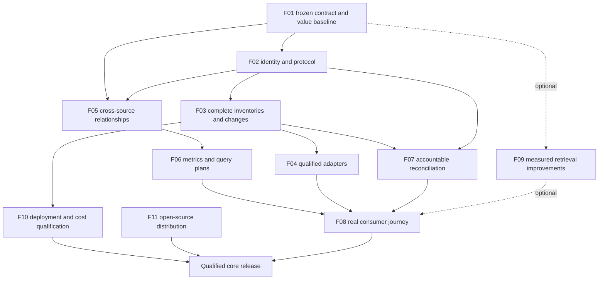

# Knowledge Layer completion plan

**Assessment date:** October 3, 2026. **Inspected baseline:** `c3f2e30`. **Status:** proposed delivery plan; the work below is not implemented or qualified by this document.

## Product decision

Finish Knowledge Layer as a small, self-hosted, permission-aware company context service. It should preserve existing knowledge from warehouses, documents, catalogs and semantic systems; support accountable agent curation; and return the exact meaning, relationships, metrics, rules and evidence that a customer-selected harness needs for a task. Source access remains read-only. Changes occur in Knowledge Layer's own registry.

Keep the combined API/UI image, PostgreSQL registry and optional worker from the same image. Keep models, embeddings, OCR and vendor SDKs optional. The first supported deployment is one organization per installation, with independently scoped business units and sources. A shared hosted multi-tenant product is a separate undertaking.

The finished product must make this journey work: install → authorize a source → import existing meaning → curate missing meaning → review/publish under company policy → connect a harness → answer a business question using separately authorized source queries → explain the result and its evidence → maintain that meaning through source and permission changes.

“Single source of truth” should mean an accountable index of company knowledge and its authorities. A response must declare connected scope, missing coverage, native revision, observation/completion clocks, validity, freshness and conflicts. It cannot guarantee that every company system is connected or that an unavailable upstream system has no newer truth. Preserve disagreement until an authorized owner resolves it.

## Current offering and evidence

This assessment inspected repository documentation, source signatures and relevant code windows, dependency manifests/lockfiles and CI. It researched official specifications, vendor documentation and primary papers. It did not rerun integration tests, query customer data, deploy a cloud service or activate another harness. The latest recorded clean-checkout regression is **737 tests at `b527e67`**; only documentation changed before this assessment's baseline. See the [guidance qualification](company-guidance-qualification-2026-10-03.md).

GitHub metadata readback confirmed `Quiet-Victory-Labs/knowledge-layer` is private, unarchived, with default branch `main` and no latest-release tag returned on the assessment date. This is repository metadata verification, not a fresh audit of branch protection, CI history or security controls. The code's Apache-2.0 license and documented release process are foundations for an open-source offering; public artifact availability is a separate milestone.

| Area | Current capability | Completion gap |
| --- | --- | --- |
| Small deployment | API/UI container, PostgreSQL, Compose, Helm, optional worker/extras | Clean-machine installation, measured total footprint, supported cloud deployments and operating cost |
| Discovery | Bounded PostgreSQL/ClickHouse/SQLite metadata, Iceberg metadata, object/local document and external-adapter paths; protocol 1.3 scoped inventory staging and worker integration | Qualified vendor accounts, estate-scale capture/projection, resumable native cursors, native change feeds and source permissions |
| Federation | Adapter 1.2 imports six namespaced semantic definition kinds; protocol 1.3 portable exports preserve complete returned native records and declared provenance | Restricted-account catalog qualification, imported relationship graphs, authority mappings and conflict reconciliation |
| Curation/governance | Evidence-backed proposals, independent review, versioned source publication, audit records | Delegated unattended policies, complete dependency impact, bulk review and customer IdP qualification |
| Semantic contracts | Descriptions, grains, same-snapshot joins, single-field metrics, query guidance, unexecuted SQL examples | Cross-source typed identity/join contracts, dimensions/filters/time/cohorts/composite metrics and bounded query plans |
| Ontology/glossary | Versioned concepts, evidence graph, reviewed glossary, RDF projection, pinned draft Ossie preview | Reviewed cross-domain mappings, stronger standard provenance and round-trip/shape qualification |
| Refresh | Durable jobs, retries, leases, hourly/daily/weekly/monthly schedules, independent attempt/completion clocks | Large-state reconciliation, explicit tombstones, worker fencing/load, alert delivery and curation dispatch |
| Agent interfaces | Compact/advanced MCP, HTTP/OpenAPI, reviewed company skill/rule exports | Actual harness/version matrix, modern MCP wire/auth tests, live skill activation/revocation and compact task context |
| Permissions | OIDC/JWT/CSRF, approved source identities, whole-connection metadata grants | Native document/field permission propagation, cache revocation and customer identity integration |
| Open-source distribution | Apache-2.0, contribution/governance/security/release documents, CI and lockfiles | Public reporting route, independent license/security review, signed artifacts and verified distribution |

The acceptance program must distinguish governed meaning from query execution and analytical results. A synthetic fixture can exercise identity, timing, grain and missingness contracts; it cannot establish model uplift, dependable live-source joins or business value. Private real-source pilot details are excluded from the public tree. Cross-source bridges require typed reviewed evidence and separate source execution qualification.

## What the 2026 landscape changes

| Verified direction | Implication for this product |
| --- | --- |
| Google now documents Knowledge Catalog, formerly Dataplex Universal Catalog, with agent context/MCP and structured/unstructured semantics. DataHub documents context generation from collected metadata, query history and semantic definitions. | Integrate those existing investments. Our proposed differentiation is portable, governed meaning across systems/business units, customer-selected harnesses and inexpensive self-hosting. This positioning is an inference, not evidence of market demand. [Google documentation](https://docs.cloud.google.com/knowledge-catalog/docs), [DataHub documentation](https://docs.datahub.com/docs/features/feature-guides/context/context-generation). |
| Databricks metric views carry agent-facing names, formats and synonyms. Snowflake semantic views bind entities, dimensions, metrics, relationships and verified questions/queries. | Read their original semantics and authority; retain dialect-specific constructs. Use verified query examples as evidence with a separate verification clock and environment. Do not flatten a native model into prose or assume that a synonyms list establishes equivalence. [Databricks agent metadata](https://docs.databricks.com/aws/en/uc-semantics/agent-metadata), [Snowflake Cortex Analyst](https://docs.snowflake.com/en/user-guide/snowflake-cortex/cortex-analyst). |
| MCP `2026-07-28` is released and changes transport, routing, cache hints and authorization. SDK availability does not establish server/client conformance. | Support a declared compatibility matrix. Validate resource/audience/issuer binding, per-request authorization and authorization-specific caching; retain a tested legacy route while customers migrate. Do not equate protocol statelessness with stateless business operations. [Release](https://blog.modelcontextprotocol.io/posts/2026-07-28/), [authorization](https://modelcontextprotocol.io/specification/2026-07-28/basic/authorization). |
| Agent Skills offers a common package format and progressive disclosure; permission semantics remain client-dependent. | Keep company guidance instruction-only and live-bound. Qualify named clients and support generic HTTP/custom harnesses. Portable files are distribution artifacts; the live service is the authority for effective guidance. [Specification](https://agentskills.io/specification). |
| Apache Ossie, formerly OSI, provides semantic interchange. Current core main is explicitly draft `0.2.0.dev0`, with breaking shape changes. dbt MetricFlow already builds SQL from declared semantic models. | Keep the native evidence/governance contract authoritative. Pin interchange schemas/commits, provide loss reports and versioned adapters, and delegate to existing semantic engines where available. Interchange validation is not execution validation. [Ossie core](https://github.com/apache/ossie/blob/main/core-spec/spec.md), [MetricFlow](https://docs.getdbt.com/docs/build/about-metricflow). |
| Cube models member access, row filters and masking; Microsoft Graph distinguishes selected-resource permissions from broad access and offers delta feeds. | Preserve source authorization semantics. A connector service account's ability to read metadata is not a user's permission to receive it. Permissions and deletion need their own reconciliation path. [Cube policies](https://docs.cube.dev/reference/data-modeling/data-access-policies), [Selected permissions](https://learn.microsoft.com/en-us/graph/permissions-selected-overview), [Graph delta](https://learn.microsoft.com/en-us/graph/api/driveitem-delta?view=graph-rest-1.0). |
| PROV-O and SKOS remain stable W3C Recommendations; SHACL 1.2 is a September 2026 Working Draft. | Extend RDFLib projections with standard provenance and reviewed mapping semantics. Qualify stable SHACL shapes where useful. Defer draft-specific inference features and general ontology reasoning. [PROV-O](https://www.w3.org/TR/prov-o/), [SKOS](https://www.w3.org/TR/skos-reference/), [SHACL 1.2 status](https://www.w3.org/TR/shacl12-core/). |

These are complementary systems and formats, with different license, operational and product boundaries. Their existence does not qualify our adapters. Refresh this research before choosing a release dependency or promising interoperability; future announcements and unreleased drafts are not shipped capabilities.

## Research principles to apply

1. **Separate evidence from instruction authority.** CaMeL studies control/data separation; PoisonedRAG shows that retrieved documents can manipulate answers. Source citations alone are not an injection defense. Imported documents, catalog descriptions and upstream `ai_context` remain source material; only separately published company guidance is instruction authority. Enforce tool/source/egress decisions in code and credentials. Include malicious source documents and fabricated policy authority in tests. These studies motivate the design; they do not prove that Knowledge Layer defeats prompt injection. [CaMeL paper and research implementation](https://arxiv.org/abs/2503.18813), [PoisonedRAG](https://www.usenix.org/conference/usenixsecurity25/presentation/zou-poisonedrag).
2. **Treat meaning as scoped, temporal claims.** Apply PROV-O's separation of entities, activities and agents, and SKOS's explicit mapping relations. Keep upstream fact, local interpretation and decision distinct. Add valid-time and observed/recorded-time semantics only where the source supplies them; unknown native time stays unknown. An exact-match mapping has stronger consequences than a related/close match and requires corresponding review.
3. **Test the enterprise workflow rather than SQL syntax alone.** Spider 2.0 studies multi-step enterprise SQL tasks. Our own value evaluation should include documentation retrieval, identity resolution, metric choice, dialect, access, result verification and refusal. A published benchmark's model score is not a local quality estimate. [Spider 2.0](https://arxiv.org/abs/2411.07763).
4. **Separate retrieval quality from answer quality.** Use deterministic source/result checks and independent human gold judgments; retrieval coverage, grounded claims, correct decisions and useful refusals are distinct scores. RAGChecker is a useful diagnostic design reference, not a replacement for business validation. [RAGChecker](https://proceedings.neurips.cc/paper_files/paper/2024/hash/27245589131d17368cccdfa990cbf16e-Abstract-Datasets_and_Benchmarks_Track.html).
5. **Choose graph retrieval by task and measured gain.** GraphRAG is aimed partly at corpus-wide summarization using generated community summaries. It does not make a metric/join correct. Use our current evidence graph for bounded paths and dependency traversal; evaluate richer GraphRAG as an optional document capability only after cost, permission and value tests. [GraphRAG research](https://arxiv.org/abs/2404.16130), [global-search method](https://microsoft.github.io/graphrag/query/global_search/).

## Technology and package decisions

The lockfile/current root environment was inspected: MCP 2.2.0, FastAPI 0.142.2, Pydantic 2.13.5, SQLAlchemy 2.1.1, Alembic 1.20.0, Psycopg 3.3.6, PyIceberg 0.12.0, RDFLib 7.6.0 and pypdf 6.19.0. Optional FastEmbed 0.8.1 is locked but not installed in the root environment. These are observed versions, not a claim that all are the newest or vulnerability-free.

| Decision | Intended use and qualification |
| --- | --- |
| Retain Python/FastAPI/Pydantic, SQLAlchemy/Alembic/PostgreSQL and React/Vite/Cytoscape | Extend current implementations. Optimize queries, metadata representation and payloads before introducing more services. Build the UI into the service image; customers should not need Node to run it. |
| Establish runtime support policy | Python is currently restricted to 3.14 and frontend tooling to Node 26. Test a supported contributor matrix before widening constraints. Prefer a qualified LTS frontend build line; Node 26 is Current on this assessment date and its LTS transition is scheduled for October 28. Keep security patches current without blanket major upgrades. [Node release schedule](https://github.com/nodejs/Release), [Python support status](https://devguide.python.org/versions/). |
| Add SQLGlot for bounded SQL AST work when implementing F06 | Use dialect-specific parsing, identifier/type checking, expression validation and explainable compilation for a deliberately small metric subset. Unsupported expressions refuse or delegate. Parsing is not a security sandbox, source-role enforcement or proof of equivalent results. Pin and test supported dialects. [Official project](https://github.com/tobymao/sqlglot), [lineage API](https://sqlglot.com/sqlglot/lineage.html). |
| Keep PostgreSQL lexical retrieval default; benchmark optional pgvector | Our current lexical candidate ceiling can miss semantic-only matches. Evaluate unioned lexical/vector candidates and scoped reranking on held-out questions. pgvector documents reduced approximate recall with filters and iterative scans; test authorization-filtered recall and exact-search crossover before enabling ANN. Preserve an installation with no embedding download. [pgvector documentation](https://github.com/pgvector/pgvector). |
| Use RDFLib; optionally add pySHACL to verification tools | Validate exported provenance/mapping shapes and exact round trips with bounded graphs; disable unneeded inference. No required graph database or general OWL reasoner. [pySHACL](https://github.com/RDFLib/pySHACL). |
| Add Hypothesis as a development dependency for stateful/high-risk contracts | Test authorization monotonicity, pagination/replay invariants, temporal validity, revision transitions and metric dimensional checks. Use domain-specific properties and regression counterexamples, not tests that mirror implementation. [Documentation](https://hypothesis.readthedocs.io/en/latest/). |
| Optional OpenTelemetry/OTLP instrumentation | Emit bounded request/job/reconciliation durations, source error codes, queue age, payload bytes and freshness signals. Keep collector/vendor choice external; source text and model prompts are excluded by default. GenAI conventions have moved to their own repository; pin any evolving conventions and only record model usage for components we actually run. [Current conventions repository](https://github.com/open-telemetry/semantic-conventions-genai). |
| Evaluate Docling only as an isolated opt-in extraction adapter | Test scanned PDFs, layouts and tables against real document fixtures, resource deadlines and model/data licenses. Preserve locator fidelity and extraction completeness; OCR must not turn uncertain cells into certified metrics. Keep lightweight text extraction available. [Docling documentation](https://docling-project.github.io/docling/). |
| Use existing CycloneDX exports plus CI vulnerability scanning and signed artifacts | Review every shipped extra and platform, resolve missing license metadata, and verify artifacts after distribution. Trivy, Sigstore/Cosign and PyPI Trusted Publishing are candidate build/release tooling, not runtime services. [Trivy](https://trivy.dev/docs/latest/guide/), [Sigstore signing](https://docs.sigstore.dev/cosign/signing/signing_with_containers/), [PyPI Trusted Publishing](https://docs.pypi.org/trusted-publishers/). |

**Implementation note, October 4, 2026:** the bounded pySHACL verification slice now has an optional `semantic-validation` extra and [offline Turtle CLI](rdf-validation.md). Canonical SHACL Core shapes are packaged at `src/knowledge_layer/schemas/knowledge_shapes.ttl` for checkouts and wheels. The checker accepts at most 5 MiB of UTF-8 Turtle and 50,000 triples, with inference, JavaScript, advanced rules, custom shapes and IRI fetching disabled. Its receipts report structural conformance, not source truth, authorization, freshness or executed queries. It is not a runtime export/publication gate or general OWL reasoner; wider ontology and cloud qualification gaps in this plan remain separate.

Do not require Kafka, Redis, Kubernetes, a vector service, a graph service, an embedded LLM, a mandatory dbt/Cube runtime or an agent orchestration framework for the core journey. Do not promise universal SQL transpilation, automatic business equivalence or fully enforceable exported prose. Revisit optional infrastructure only against measured acceptance failures.

## Delivery program

The order below is driven by dependency and risk, not a calendar estimate. Each package is a reviewable implementation increment with a named acceptance gate. Architecture owner: QVL maintainer. Meaning/authority acceptance: customer domain steward. Security/release review: independent qualified reviewer. Provider/harness qualification: integration maintainer using restricted accounts. External credentials, legal review and monitored-contact ownership are prerequisites to those specific gates; they do not block independent implementation.

### F01 — Freeze the supported contract and value benchmark

**Priority:** start first. **Extend:** architecture, qualification reports, `evaluate_knowledge_journey.py`, `evaluate_quick_agent.py` and existing evaluation fixtures.

Create one capability/support matrix: implemented, offline-tested, live-qualified, experimental and unavailable. Pin API, semantic-contract, connector-protocol, interchange and MCP versions independently. Define behavior for unknown data, over-budget requests, stale state, conflicts and unsupported constructs. Add deprecation/compatibility policy.

Freeze an initial set of at least 80 steward-labeled questions before feature tuning: 20 definition/identity questions, 20 metric/grain/time questions, 20 cross-business-unit/document questions and 20 answerability/permission/conflict/drift cases. Use synthetic finance and support domains with divergent same-named metrics. Previously examined tasks are regressions, not fresh holdouts. Reserve unexamined questions and preregister sample-size, uncertainty and expansion rules; an 80-question seed alone is not sufficient to measure a small gain. Real-data evaluation requires privately recorded rights approval. Public examples must not copy customer records.

Compare the same question, source snapshot, harness/model/version and query budget using schema-only, imported context and reviewed Knowledge Layer context. Blind the consumer to expected answers and curation files. Record correctness, metric/cohort choice, citations, refusals, source reads, calls, bytes, tokens when available, elapsed time and model/compute cost. Evaluation workload is read-only at enterprise sources. Reuse the customer's audited execution boundary.

**Gate:** independently checked gold answers and reproducible paired receipts. Before measuring, preregister a useful-answer gain target of at least 10 percentage points over schema-only on ambiguous/domain-dependent questions, with no observed reduction in exact-result correctness on supported metric cases. Publish denominators and paired uncertainty; a statistical non-inferiority claim requires its own powered design and margin. A small inconclusive sample requires expansion, not a claimed win. Zero permission leakage/source writes is a mandatory test gate, not a statistical confidence claim. If meaning adds no measured value, improve contracts/retrieval before expanding the connector menu.

### F02 — Complete identity, authorization and MCP compatibility

**Priority:** safety foundation. **Extend:** `access.py`, `oidc.py`, `auth.py`, source policy/grants, gateway and existing MCP registrations.

Define users, groups, service principals and scoped steward/source-manager rights inside one organization. Add asset/document/field policy handles with provenance, effective revision and expiry. Apply authorization before retrieval, graph expansion, counts and exports. Preserve row-policy bindings for execution in the native engine; do not pretend that reading a catalog permits bypassing warehouse row restrictions. For sources that cannot safely supply effective end-user ACLs, require separately scoped audiences/credentials or decline content retention.

Qualify supported modern and legacy MCP versions over HTTPS with protected-resource discovery and appropriate OAuth/JWT scopes. Verify issuer/audience/resource binding, stale credentials, key rotation, denied methods and disallowed token forwarding. Where the service or its qualification client fetches discovery/CIMD metadata, test approved destinations, redirect revalidation, DNS rebinding and cloud-metadata denial; private enterprise endpoints need deliberate operator allowlisting. Guessing or replaying a workflow handle under another principal must fail. New protocol routing headers must agree with parsed request bodies. Authorization cache keys must include the verified principal and effective policy/grant revision. Revocation invalidates managed caches and dependency use and refuses new exports; previously delivered files cannot be recalled and require live revalidation before reuse. [MCP security guidance](https://modelcontextprotocol.io/docs/2026-07-28/tutorials/security/security_best_practices).

**Gate:** a real IdP, two business units, overlapping groups, service principal and restricted sources pass positive/negative/revocation cases across HTTP, both MCP surfaces, graph, export and background jobs. Denied objects must not leak through titles, result counts or related evidence. Wire tests declare exact server/SDK/client versions. No multi-tenant readiness claim.

### F03 — Make large inventories and change reconciliation complete

**Priority:** prerequisite for company-scale federation. **Extend:** external adapter, connectors, discovery worker, snapshot persistence and source freshness.

Version the connector contract to support bounded pages, continuation checkpoints, stable native identities, per-scope coverage and resumable discovery. Bind checkpoints to source/scope/policy identity and the source's consistency or change watermark when available. A completed listing is scoped to that observation window; it is not proof that a changing upstream estate stayed frozen. Commit a complete-scope snapshot only after every required page completes and validates. Keep partial/failed/denied states explicit. Stream or stage metadata under an absolute job/byte/asset budget; do not require one giant response or silently raise current caps.

Extend registry persistence and projections as part of this package. Current external imports cap a response at 100 assets/5,000 columns/2 MiB, and `save_snapshot` materializes full snapshot/graph JSON with a 5 MiB cap. Upstream pagination alone cannot provide estate-scale bounded memory. Stage versioned entity/evidence rows in PostgreSQL, validate a complete version manifest and atomically switch the effective version; page contracts/graph/evidence projections over that manifest. Preserve existing snapshot compatibility through migration and round-trip tests. Until this is qualified, support deliberately small approved/sharded scopes and report their limits rather than advertising F10's larger target profiles.

Add explicit deletion/withdrawal tombstones and permission-revocation events. A completed comparable listing or source deletion event may establish removal; absence in a page, timeout, changed scope or denied read may not. Preserve rename/replacement identity, schema/native field IDs, raw revisions and observation clocks. Handle expired cursors with bounded re-census. Webhooks are hints; reconciliation determines effective state.

**Gate:** multi-page retry/replay, reordered pages, duplicate IDs, crash before commit, partial scope, denied page, replacement-under-same-name, source tombstone and cursor expiry all preserve correct coverage and active meanings. Memory is bounded by processing batch rather than full estate size. Read-only source credentials prove no mutation capability.

**Implementation update:** staged manifests now expose bounded current-scope
discovery and exact entity selections with complete same-manifest evidence over
HTTP and both MCP surfaces. Final grant/source/policy/head checks use explicit
PostgreSQL READ COMMITTED visibility without changing mutation/engine defaults.
This makes large discovery usable by a harness, but remains discovery-only:
estate-scale approved semantic projections remain open.
[Workflow and limits](staged-inventory-consumption.md).

The [paged adapter refresh](paged-adapter-refresh.md) adds explicit protocol 1.3
orchestration through the existing worker and schedules. Typed inventory job
results, permission/profile/watermark rechecks, bounded streaming, scoped head
commits and exact failed-attempt retirement are implemented. Inventory discovery
does not certify meaning or activate legacy semantic publication. Generic fixture
and package results do not qualify a vendor account, native ACLs, resumable vendor
cursors or the full F03 acceptance gate.
[Local qualification](paged-adapter-qualification-2026-10-03.md) records 1,883
clean regression tests, isolated package installs and 15 real paged worker checks
on a disposable PostgreSQL registry, separately from those remaining gates.

### F04 — Ship the first useful federation adapters

**Priority:** start with F02/F03; expand by tested families. **Extend:** operator-approved external adapter protocol and source onboarding, rather than adding every SDK to the core image.

| Wave | Deliverables | Qualification boundary |
| --- | --- | --- |
| A: existing enterprise knowledge | DataHub read adapter; Google Knowledge Catalog/Dataplex adapter; dbt manifest/semantic artifact import | Two units with same-named conflicting terms/metrics; native IDs/owners/definitions/revisions, relationships and policy bindings survive ingestion and retrieval |
| B: live cloud/document estate | BigQuery read-only metadata adapter; Google Drive; Microsoft Graph OneDrive/SharePoint | Restricted project/site/file scopes, document locators, permissions, change tokens, deletion, credential rotation and denied access |
| C: additional native semantics | Snowflake semantic views, Databricks Unity Catalog metric views, then Cube | Preserve expressions, model versions, dimensions, joins, native policy references and delegated execution route; refuse unsupported/lossy translations |
| D: further catalog ecosystem | Collibra, Alation, OpenMetadata and customer adapters | Add only with provider documentation, a restricted test environment and maintained conformance evidence; provide the same SDK/sample adapter path to contributors |

Google Drive's change feed and Graph delta provide real change-tracking mechanisms; their access/permission coverage still needs per-provider tests. Selected resource permissions are attractive for Microsoft integrations, but do not assume they qualify every permission-scanning API. Keep read-only service scopes; if an ACL procedure requires write/full-control privileges, redesign it or declare the unsupported boundary. [Drive change guide](https://developers.google.com/workspace/drive/api/guides/manage-changes), [Graph delta](https://learn.microsoft.com/en-us/graph/api/driveitem-delta?view=graph-rest-1.0).

**Gate:** each released adapter has install/auth instructions, minimum scopes, scope/coverage semantics, live restricted-account receipts, negative/rotation/drift tests, exact supported vendor/API versions and a maintainer. Existing catalog approval remains upstream provenance; it does not automatically publish local interpretation or company instructions. The minimum federation reference set is one catalog read adapter (DataHub first), one independent semantic artifact import (dbt first) and one permission-qualified document provider, spanning two semantic authorities/business units. Other Wave A adapters and later waves graduate independently with explicit support tiers; finishing every named vendor is not a core-release prerequisite.

The [offline adapter check](adapter-conformance.md) supplies the contributor
contract path without an SDK or source credentials. It shares live discovery's
validator, preserves unknown/partial coverage, and reports content-free wire
receipts. Supplied response validity does not close provider/account qualification.

The [native semantic adapters](native-semantic-adapters.md) now preserve complete
selected dbt v12 records and fixed-query DataHub glossary observations through
the protocol 1.3 worker path. Adapter-side capture/paging, scoped identities,
profile/credential invalidation, full evidence and precise unknown states extend
the existing readers without additional SDKs or models. Two synthetic business
units keep conflicting same-name metrics separate in actual PostgreSQL worker
and selection readbacks. This closes the bounded integration slice; restricted
vendor accounts, native permissions, document-provider qualification and the
full F04 gate remain open.

The [catalog-agnostic import](catalog-agnostic-import.md) adds a portable
`knowledge-catalog-export-v1` package for metadata captured by existing
customer-authorized tools or thin integrations. Four vendor-neutral inventory
kinds preserve full returned native objects and explicit coverage, redaction,
clock and revision declarations. Data-only JSON Pointer mappings and local
`check`/`map`/`pins` commands require no vendor SDK, model or new backend. Optional
platform scope bindings pin account, namespace, selector population and mapping
into the existing protocol 1.3 profile. The sample and worker reuse the same
staging, fencing and exact evidence retrieval path.

This is implemented generic-contract support with offline and synthetic
managed-worker qualification boundaries, not a live Databricks, Alation, Atlan
or Collibra connector release. Each real exporter still needs its own native
pagination/completion, permissions, denial, change, rotation and version evidence.
Declared complete-empty differs from a partial or denied read; recent capture
bytes do not establish native freshness. Vendor authority, native ACLs and
relationship meaning are not transferred into local approval. The full F04 gate
and permission-qualified document provider remain open; all named vendor waves
are not prerequisites for shipping this bounded contributor path.

### F05 — Add typed cross-source relationships and authority reconciliation

**Priority:** core product-value gap. **Dependencies:** F01; policy handles from F02. **Extend:** `contracts.validate_assertion`, proposals/review, `federated.py`, RDF projection and existing dependency checks.

Represent each relationship with independently pinned connection/native asset/field identities, snapshot/evidence versions, identifier namespaces, directional cardinality, effective-time rule, coverage/missingness diagnostics, join predicates and allowed usage. Distinguish identity equivalence, a business relationship, a physical foreign key and sampled overlap. An analyst must be able to inspect why an approved bridge is valid and which populations it excludes.

Add scoped semantic identities and reviewed mapping types: equivalent, narrower, broader, related and explicitly conflicting. Preserve source unit, currency, accounting/cohort/time policy and authority. Two business units can intentionally retain different revenue or active-customer definitions. A company-wide metric requires a reviewed composition/conversion/cohort policy, not a text similarity winner. Invalidate a mapping if either side's evidence, permissions, policy or publication changes.

**Gate:** a real two-source use case and the second-domain fixture work through MCP without private textual operator hints. Cases cover composite keys, many-to-many fanout, missing/duplicate identities, effective-dated mappings, different currencies/timezones, conflicts and revoked access. Unproved bridges refuse planning. Live-source execution failures require separate investigation; this product gate must not mark them fixed through synthetic tests.

### F06 — Finish metric definitions and bounded query planning

**Priority:** core product-value gap. **Dependencies:** F01/F05; effective policy bindings from F02. **Extend:** native semantic contracts, metric query guidance and pinned interchange export.

Introduce a versioned typed semantic representation for measure/expression, unit, dimensions, filters, row grain, aggregation level, time column/calendar/timezone, cohort, null/zero/empty semantics, additive behavior and dependencies. Support an explicit first subset: sums, counts, distinct counts, averages, filtered measures and ratios with aligned cohorts. Reject averaging ratios or summing non-additive measures without a reviewed rule. Monetary conversions require an approved rate source and date policy. Store native expressions unchanged alongside parsed/normalized constructs; never silently drop unsupported semantics.

Expose a bounded planning tool: return the selected metric versions, dependencies, required source fields, approved relationship path, execution route, dialect-specific SQL or native semantic query, cost/scan checks available from that engine, and result-validation obligations. Use SQLGlot only for supported expressions/dialects. Delegate existing dbt/Cube/Snowflake/Databricks definitions to their native runtime when a compatible customer tool is available.

For multiple engines, return independently authorized source subplans and an explicitly approved result-combination contract. Refuse incompatible identities/grains/cohorts. Leave query execution and bounded result combination with the customer's harness or query service. Every plan reports `not_executed` until independent execution evidence exists. A registry snapshot verifies the recorded schema, not the current live schema or table contents.

**Gate:** exact-result fixtures and real restricted-source readbacks for each supported dialect, including all-null/zero/empty inputs, distinct-count overlap, denominator zero, fanout, timezone/DST, historical cutoff and changed schema. Native round trips either preserve meaning or return a precise loss/unsupported report. Verified examples carry SQL hash, source/execution context, schema/version, parameters/cohort, result check and verification clock; their validity expires on relevant changes. No universal composite-metric compiler claim.

### F07 — Connect refresh to accountable unattended curation

**Priority:** maintenance correctness. **Dependencies:** F02/F03; applies to F04–F06 as they land. **Extend:** schedules, refresh jobs/worker, work packets, decisions, publication and audit.

After discovery, calculate dependency impact and enqueue version-bound curation work for the customer's harness. Provide polling first and optional authenticated callbacks/outbox delivery; sign destinations through operator configuration, retry idempotently and prevent source-directed callbacks. Record discovery, interpretation, review, publication and consumer freshness as separate stages. Customer hourly/daily/weekly/monthly schedules and budgets remain explicit.

Add a reviewed autonomy policy for customers who authorize unattended operation: permitted source/task scope, decision classes, service principal, evidence requirements, budgets, expiry, rollback and kill switch. A platform policy gate may publish only the allowed classes after deterministic checks. Free-text instructions or agent confidence cannot grant publication rights. Start with low-risk unchanged/technical metadata and explicitly authorized imported authority; novel joins, sensitive policy changes and semantic conflicts require the responsible review route unless a reviewed policy specifically permits them.

Implement worker fencing at the snapshot/publication commit boundary before scaling worker replicas. Carry claim generation through child execution; an expired worker cannot commit after a new owner acquires the job. Add fairness/per-source concurrency, cancellation, bounded retries, retention, freshness deadlines and monitored alert delivery. Retention may remove local sensitive excerpts where required while preserving minimal non-sensitive audit provenance under customer policy.

**Gate:** seven-day endurance test with outages, lost workers, lease expiry, restart, permission withdrawal and conflicting refresh/curation runs, plus controlled-clock tests for calendar/daylight-saving transitions. A newer revision cannot receive an older decision. Failed or incomplete discovery and unqualified empty results cannot advance the complete-inventory clock; a verified complete empty inventory can. Complete discovery with partial curation advances only its discovery clock, while curation/publication remain incomplete. Policy withdrawal stops publication. No upstream writes occur, and alert delivery is independently verified.

**Implementation update:** the opt-in `publish_reviewed_unchanged` class is
implemented and qualified separately at `c445c3a`: immutable steward-reviewed
policies, direct scoped service identity, exact metadata/approval pins, expiry,
publication budget, atomic run/audit and withdrawal of owned publications.
PostgreSQL locking, rollback and populated v13 recovery passed the disposable
drill. [Policy workflow and limits](autonomy-policies.md). This closes the first
bounded delegation class; broader decision classes, customer harness operation,
broader retention/alert delivery and the seven-day gate remain open.

Offline [abandoned-inventory retention](inventory-retention.md) now reuses the
existing registry/source locks and audit ledger: explicit cutoff and budgets,
exact preview binding, atomic deletes of already-aborted unreferenced runs, and
no source IO or clock writes. The disposable PostgreSQL drill verifies competing
applies, audit-failure rollback, exact row readbacks and unchanged heads/history.
This closes one bounded local storage operation; it does not purge sensitive
historical evidence, select a legal retention age or establish endurance.

The [withdrawal qualification](enterprise-withdrawal-qualification-2026-10-03.md)
adds connector-approval-independent kill switches, sanitized guidance withdrawal,
failed-document dependency suspension, blocked receipt refusal and a real
disposable service-account IdP journey. Customer identity/native harness and
operating qualifications remain separate from those local results.

### F08 — Qualify consumption and finish the user journey

**Priority:** continuous value feedback. **Dependencies:** F01/F02; incorporates F04–F07. **Extend:** compact workspace/context tools, HTTP/OpenAPI, company guidance exporter, onboarding and existing UI.

Create a compact task-context response with explicit scope, answerability/blockers, selected definitions/metrics/relationships, effective company guidance and stable evidence references. Let the harness drill down instead of receiving the whole graph. Return a context receipt binding principal/policy revision, semantic revisions, source observations, selected constraints and evaluation time. Revalidate before planning or source execution; a receipt is provenance, not proof that the harness obeyed it.

Qualify actual Codex and Claude Code integrations first, plus a plain HTTP/custom client, with exact client/model/version and capability records. Gemini and Cursor are subsequent independent qualification targets, not reasons to delay a release already qualified for the reference set. Test discovery, OAuth, retrieval, proposal submission, denied publication, guidance loading, live withdrawal, expired copies and unavailable registry. A harness that cannot enforce revalidation gets a stated lower support tier; only tested versions receive a native integration claim.

Complete the operator/steward journey in the existing UI: source scope/permissions, coverage and freshness, review queue, semantic conflicts, approved relationship/metric inspection, guidance versions, schedule/worker state and context export. Provide one useful real task in the quickstart, with customer-selected harness setup. Verify keyboard/accessibility, clear empty/error/denied states and responsive geometry. No mandatory in-app chat or model API key.

**Gate:** a new evaluator installs without maintainer assistance, connects three source categories, imports meaning, curates/publishes, asks a held-out question, verifies source results and observes correct behavior after drift/revocation. Exact source results and policy denial are scored independently from UI/task completion. F01's paired benchmark is rerun on the frozen questions without changing gold answers.

The [native CLI qualification](native-harness-qualification.md) closes the scoped
Codex consumption/withdrawal fixture at clean `ad8cd10` (1,339 tests). Accurate MCP
reader effect hints fix approval denials without approving mutations. Codex 0.158.0
with requested `gpt-6-astra` uses protocol 2025-06-18; provider-resolved model identity
is not independently reported by its JSON events. Claude's weekly account limit
prevented an end-to-end run. Native skills, OAuth, customer permissions, proposal/
publication denial, natural expiry and registry outages in native clients remain
open. This is progress within F08, not completion of its full acceptance gate.

The optional [operator receipt key ring](context-receipt-keys.md) removes the
single-process receipt restriction for explicitly configured replicas of one
registry. File rotation/removal, independent-store and fresh-interpreter HTTP
checks, both MCP surfaces, expiry and current permission/publication/guidance
refusal are covered separately. The local process-key default remains available;
customer secret-manager mounts, replica operations and cloud SLOs remain open.

### F09 — Improve retrieval and document understanding only where measured

**Priority:** conditional on F01 misses. **Extend:** lexical concept index, current retrieval, document evidence and existing optional embedding path.

Measure semantic-only recall, aliases, multilingual terminology, scope disambiguation and relation-path recall under current permission filters. Add authorized unioned candidates/reranking only if it fixes a measured failure within resource budgets. Cache keys bind source/content/model/policy revisions. Avoid sharing unauthorized vectors, text, result counts or graph summaries across audiences. Embedding models and remote egress require customer opt-in.

Keep exact document locators, table cell spans where available, extraction state and source revision. Evaluate optional OCR/layout extraction in isolated workers; mark uncertain text and unsupported formats. Require separate review before a document-derived formula becomes an active metric. Include malicious/contradictory/stale documents in retrieval and guidance tests.

**Gate:** improved held-out evidence recall and downstream correct decisions, no permission leakage, bounded warm/cold memory and reproducible indexing/revocation. Retain the model-free path with its declared capabilities. A higher retrieval score alone is insufficient for release.

### F10 — Prove low cost, reliable operations and portable deployment

**Priority:** release gate; implementation alongside other packages. **Extend:** Compose, same-image worker, Helm, migration/recovery drills and audit exports.

Define pilot and scale profiles before load testing, including source distribution, retained evidence density, request mix, response sizes, concurrent refresh load and the exact model-free configuration. Proposed pilot: 25 sources, 10,000 assets, 100,000 fields and 10 concurrent consumers on a 2-vCPU/4-GiB host including PostgreSQL. Proposed scale profile: 100 sources/100,000 assets/1,000,000 fields on a separately measured host. These targets depend on F03's registry/projection work and are not supported limits or current results. Before that work, qualify a smaller profile within actual caps. Preserve per-source/total budgets and decline excess scope safely.

Proposed pilot budgets: API+worker idle RSS at most 512 MiB without optional models; warm context p95 at most 1 second and scoped search p95 at most 2 seconds under the declared workload. Report PostgreSQL memory, disk growth, cold-start/image-download time, refresh peak RSS, retries, source API calls and full installation footprint separately. Measure actual current cloud pricing when publishing cost examples. No invented monthly cost or universal latency guarantee.

Ship clean-machine local Compose and one verified generic Linux VM+PostgreSQL path. Qualify GCP, AWS and Azure deployment recipes sequentially using the same image and documented identity/network/secret mounts. Validate outbound allowlists, HTTPS, non-root/read-only runtime behavior, migration startup, secret rotation and private source reachability. Kubernetes remains optional. Stateless/cloud platforms require a tested durable worker execution pattern; do not assume a request-only service can maintain scheduled work.

Define/measure backup retention and recovery objectives, then perform version upgrades and restore into an isolated destination with content/schema readback. Proposed pilot recovery target: RPO at most 24 hours and RTO at most 60 minutes; publish the measured boundary. Add redacted OTLP/log/metric export and customer-owned audit retention/integrity/delivery checks. Distinguish service telemetry from tamper-evident audit evidence.

**Gate:** profile measurements, seven-day failure/load behavior, clean-machine instructions and exact cloud receipts. Update support limits to measured results, not the aspirations above. Default installation requires no paid platform service or hosted model.

### F11 — Make the open-source release concrete

**Priority:** independent public-alpha gate. **Extend:** current CI, release process, governance/security/community documents and SBOM tooling.

Automate the existing schedule, company-guidance and OIDC runtime drills in isolated CI where feasible; current local-integration CI invokes migration/jobs/recovery/PostgreSQL/gateway drills but not those three paths. Keep nightly/provider qualification separate from fast PR checks. Verify installable wheel/sdist, CLI, UI image, migration and chart from the exact clean release tree, on supported architectures. Test base and connector extras separately.

Publish a tested monitored vulnerability route and named maintainers, complete current-scope independent security and dependency/data-rights/license review, and preserve notices. The existing LGPL Psycopg distribution question and Python SBOM license omissions need actual review, not automatic rejection or silent omission. Maintain an adapter contribution SDK/sample, compatibility policy, support tiers, issue templates and a reproducible synthetic demo/benchmark.

Prepare immutable versioned wheels/source archives, multi-architecture OCI images and chart, with exact commit, checksums, SBOMs and build provenance/signatures. Use approved publishing identities and verify a fresh download/start after release. Enable repository/reviewer controls and private vulnerability reporting at public launch. Public visibility, merges, tags and publication require their own authorized maintainer decisions.

**Gate:** the existing [public checklist](release-readiness.md) is closed with evidence; independently reviewed artifacts can be reproduced, verified and run without the developer checkout. An alpha can ship with declared limits before enterprise qualification. A green test run, license file or new feature list cannot substitute for these distribution gates.

## Sequence, milestones and definition of finished

F10/F11 can progress alongside semantic work. F09 is conditional and should not delay a correct lexical-only release. F04 waves are independent after the common lifecycle/policy foundation. Integrate in small PRs and keep one authoritative capability matrix as evidence accumulates.

| Milestone | Required outcome |
| --- | --- |
| Public alpha | F11 distribution gates, F01 declared scope, one safe clean-machine installation and reproducible current journey. Explicitly label unfinished native ACL, vendors, metrics and cloud qualifications. |
| Federation beta | F02/F03, F04's minimum catalog/semantic artifact/document reference set, F05, with two conflicting business units and drift/revocation behavior demonstrated. |
| Semantic consumption beta | F06/F08's typed metric/planning and actual harness journey meet F01's paired correctness/value targets. Separately diagnose external execution failures before promising dependable joined execution. |
| Qualified core 1.0 | F07/F10 operational gates; actual source/IdP/reference-harness qualification; F04's minimum reference set plus at least one live cloud warehouse; maintained support matrix; no unresolved release-blocking findings. Publish separate qualification receipts for each claimed cloud recipe; all three clouds and all named vendor/client adapters are not prerequisites to the first scoped core release. |

The core is finished when an unfamiliar customer can install cheaply, connect these supported source families read-only, preserve existing company meaning and source permissions, curate under its chosen governance policy, answer verified business questions through its own harness, and keep the knowledge current with visible coverage and failure states. Every advertised capability must name its supported scope and evidence. New vendors, multi-tenant SaaS, universal federation execution, full OWL reasoning, a skill marketplace and general automatic semantic repair remain subsequent products or optional integrations.

## First implementation slice

Start F01's frozen paired benchmark/support matrix alongside F02's identity/protocol qualification harness. Then implement F05's independently pinned cross-source relationship schema and dependency invalidation, followed by F06's dimensions/cohort/time-aware metric representation. These changes exercise source-bound meaning, relationships and metrics through the synthetic acceptance corpus. Work on release/contact/license/artifact gates independently; do not wait for every vendor adapter to make the alpha distributable.

Do not start another UI/connector expansion before these representation, permission and evaluation foundations are in place. The immediate plan is to extend existing code, not replace the platform stack.

## Implementation grounding

| Work package | Exact existing implementation/evidence to extend |
| --- | --- |
| F01/F08 | `scripts/evaluate_knowledge_journey.py`, `scripts/evaluate_quick_agent.py`, [synthetic SDK example](../examples/01_quickstart_sdk.py), [fixture provenance](public-fixture-provenance.md) |
| F02 | `access.Principal`, `oidc.OidcAgentBoundary`, source grants/policy and `gateway.py`; [source access](source-access.md), [OIDC pilot](oidc-pilot.md) |
| F03/F04 | `connectors.external_adapter._upstream_definition` / `discover`; [adapter protocol](external-connector-protocol.md), [native qualification](native-connector-qualification.md) |
| F05 | `contracts.validate_assertion` join branch (baseline lines 76–91), `federated.cited_upstream_definitions` and `federated_evidence_graph`, `ontology.project_snapshot` |
| F06 | `contracts.validate_assertion` metric branch (baseline lines 92–107), `_metric_query_guidance`, `semantic_contract`, `ossie_preview`; [contract workflow](semantic-contract-agent-loop.md) |
| F07 | `jobs.RefreshQueue.claim` / `heartbeat` / `finish`, `schedules.RefreshSchedules.dispatch_due`, `worker._run_claimed`, existing work/decision/publication paths |
| F08/F09 | `retrieval.term_context` / `search_knowledge`, `concept_index.records`, `GuidanceRegistry.resolve`, `guidance_export.export_guidance`, `PlatformApp.tsx` |
| F10/F11 | `compose.yaml`, Dockerfile, Helm chart, `drill_postgres_recovery.py`, `.github/workflows/verify.yaml`, [release process](../RELEASING.md), [release gates](release-readiness.md) |

Symbol/line references above ground the gaps in the inspected baseline and will move as implementation proceeds. The detailed current boundaries remain in [architecture](architecture.md); this plan does not override recorded qualification limits or report future work as complete.
